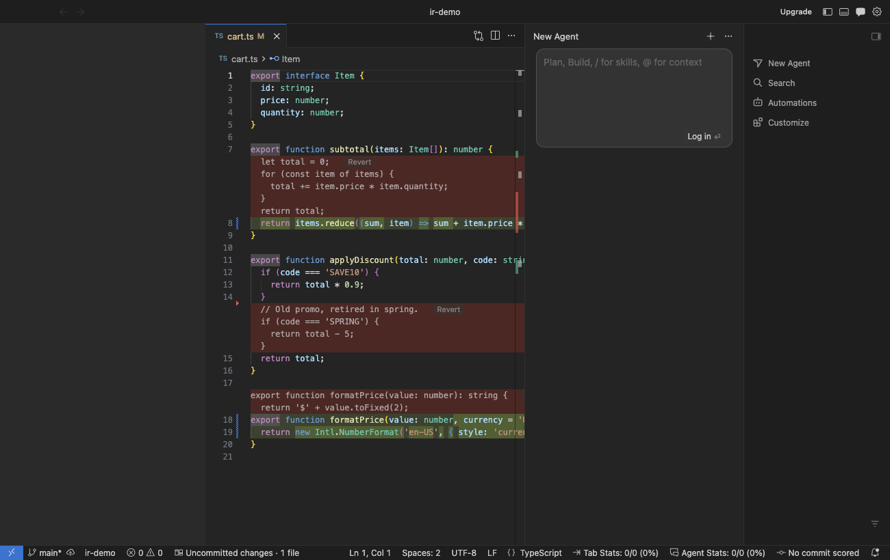

# Redline

Code review inside your editor.

Review a GitHub PR, your branch, or your staged or uncommitted changes inside the real file. The
editor stays a normal editor, so go to definition, find references, IntelliSense and edits all keep
working. As you type, the diff updates.



## Setup

Clone the repository, then build the package and install it into Cursor (or VS Code with
`install:code`):

```sh
git clone https://github.com/LReinacher/redline.git
cd redline
npm install
npm run install:cursor
```

Cursor keeps its own copy of the installed extension, so the clone is only needed to build updates.
To update, run `git pull && npm run install:cursor` and reload the window.

For removed lines to show as blocks between the lines like in the screenshot, allow the extension's
proposed API. Run **Preferences: Configure Runtime Arguments**, add this key to `argv.json`, and
restart:

```jsonc
"enable-proposed-api": ["local.redline"]
```

Without it, removed lines show as comment blocks, and the extension says so once.

## What it shows

- Added lines get a green background. Changed words inside modified lines get a stronger green.
- Removed lines appear in a red block above the change, with a **Revert** button after the first
  line. Set `redline.deletedLines` to `hover` to show them on hover instead.
- Pure additions get a CodeLens with a **Revert** action.
- The **Redline** view under Source Control groups changed files into **Shape**, **Entry points**,
  **Implementation**, and **Tests**, in reading order. The list/tree button (`redline.viewAsTree`)
  switches between flat files and folders within each group. File review checkboxes persist per
  workspace; checking a folder or group marks its files reviewed.
- Expand a file to see symbols that overlap its changed lines. Click a symbol to jump to its
  declaration. Symbols with no reported callers among the changed symbols get a **Change root** hint. Expand a symbol to inspect callers outside the
  changed symbols, including unchanged functions in a changed file. A CodeLens opens those call
  sites in the editor's references view (`redline.codeLens` controls both caller and Revert lenses).
- Moved and renamed files show where they came from, like `← src/old/name.ts`, and are diffed
  against their old content. This includes files moved with a plain `mv` that git doesn't know
  about yet.
- F7 and Shift+F7 jump to the next and previous change. Past the last change in a file, they open
  the next file.
- **Open File in Diff Editor** (editor title bar) opens the regular side-by-side diff against the
  same base. The extension leaves diff editors alone, since they draw their own diff.

Only the function name in calls to added or modified functions gets an amber underline and text
color; receivers such as `this.service` keep their normal syntax colors. Hover a
marker to see the changed symbol and open its declaration. Calls from unchanged functions and
files are marked too. A method is marked only when its own declaration/body overlaps the diff;
changes elsewhere in its file do not qualify.

For interface or abstract-method calls, Redline checks implementations reported by the language
server for visible functions. The hover labels these as a **possible implementation**, since static
analysis cannot establish which implementation will run. Visible-function lookups are cached for
the current analysis snapshot. Missing markers do not prove a target is unchanged: incomplete
call hierarchies, unsupported languages, or dynamic dispatch may leave calls unresolved. Markers
clear during refresh, after edits, and when a review ends; the tree keeps its existing behavior.

Disable this with `redline.changedCalls: false`. Customize the color using
`workbench.colorCustomizations` → `redline.changedCallForeground`. The underline does not replace
the diff's added/removed backgrounds, and markers are omitted in the native diff editor.

## Starting a review

Run **Redline: Start Review...** or use the buttons in the Redline view.

| Mode | Base | Files |
| --- | --- | --- |
| Uncommitted changes | `HEAD` | Tracked changes and untracked files |
| Staged changes | `HEAD` | Staged files |
| Against a branch | `git merge-base HEAD <branch>` | Everything on your branch, committed or not |
| GitHub pull request | Merge base with the PR's base branch | Same as branch mode |

The PR mode needs the GitHub CLI (`gh`). If the PR isn't checked out, it asks before running
`gh pr checkout`.

The editor always shows the file on disk, which is what makes language features work. In staged
mode that means unstaged edits to staged files also appear.

The file list refreshes on save and when git state changes. Open files refresh as you type.

To find moves that aren't staged, the extension copies the git index to a temp file, adds the
untracked files to the copy as intent-to-add, and runs `git diff -M` against it. Your real index
isn't touched.

## Review guide

Path-based grouping appears immediately. The view shows a progress bar and counts while finding
symbols and tracing callers, then says **Ready to review** when the complete result is applied.
Discovery uses three analysis workers with a five-second wait limit per provider request.

Analysis updates the tree once when it finishes. During subsequent updates, the previous tree stays
in place. Git status events that leave the review's base, file list, and file metadata unchanged do
not restart discovery. Editing schedules a new snapshot after a short pause; the Refresh button
forces discovery again even when the files are unchanged. Ending or switching reviews discards
pending results. Deleted files remain reviewable against their base but have no current symbols
to analyze.

The **Entry points** group is selected by the repository's entry-point path patterns, such as
resolvers, controllers, and routes. Mappers, services, use cases, and internal command/query handlers
stay in **Implementation** unless the repository explicitly includes them in its entry patterns.
A review can have no changed entry-point files when its public boundary is unchanged.

A **Change root** hint means a changed callable has no reported incoming call from another changed
symbol. It helps choose where to read within the change, but never promotes a file into **Entry
points**. A mapper called by an unchanged base class or a CQRS handler dispatched through a bus can
be a change root while remaining an internal implementation detail. Self recursion does not
disqualify a root; mutually recursive functions may have no root. Framework dispatch, interfaces,
and dynamic calls can leave edges missing. VS Code can also expose a provider failure as an empty
caller list. Missing call hierarchy support produces no change-root hint. Files without symbol
providers remain accessible normally.

Defaults recognize GraphQL, Prisma, OpenAPI/Swagger, TypeScript entities/DTOs/models, migrations,
resolver/controller files, route directories, and common JavaScript/TypeScript test names. Customize
these arrays in workspace settings (`.vscode/settings.json`) for your repository. Each array
replaces its defaults; `[]` disables its path rules. Tests take precedence, then Shape, then Entry
points, then Implementation. Supported globs are `*`, `**`, `?`, and
brace alternatives, relative to the repository root with `/` separators.

```json
{
  "redline.reviewPatterns.shape": [
    "**/*.{graphql,gql,prisma}",
    "**/*.{entity,dto,model}.ts",
    "**/contracts/**",
    "**/migrations/**"
  ],
  "redline.reviewPatterns.entry": ["**/*.resolver.ts", "**/*.controller.ts"],
  "redline.reviewPatterns.tests": ["**/*.{test,spec}.{ts,tsx}", "**/tests/**"]
}
```

## How removed lines are drawn

Neither VS Code nor Cursor lets extensions insert space between editor lines through the stable
API. Cursor's own agent diff uses an internal service (`inlineDiffService`) that extensions can't
call. The closest public option is the proposed `editorInsets` API: it adds a Monaco view zone (the
same mechanism Cursor's red blocks use) and fills it with a webview. Each block's text uses the
editor font and the theme's `diffEditor.removedLineBackground`, so it lines up with the code.

Limits of the inset blocks:

- Proposed APIs can't be published to the VS Code Marketplace, so this ships as a `.vsix`.
- Stable builds of VS Code and Cursor require the `argv.json` key above, even in extension
  development mode (F5).
- The Revert button follows the first removed line, so after a very long line it can be off screen.
- Folding a region above a block can misplace it until the next edit.
- When an editor moves in the window, for example when you split it, the workbench reloads its
  blocks' iframes and never refills them. The extension pings every block after layout changes and
  replaces the ones that don't answer, so a block can be empty for about two seconds.

Without the proposed API, each block is a read-only comment thread instead. Those also show up in
the Comments panel. The extension marks them resolved and sets the default of `comments.openView`
to `firstFileUnresolved`, so the panel doesn't pop open. A value you set yourself wins.

Diffs run in the extension host with [jsdiff](https://github.com/kpdecker/jsdiff), debounced to 60 ms
after each edit. A diff that takes longer than one second is shown as a single whole-file change.

## Development

```sh
npm install
npm test                  # unit tests for the diff logic
npm run test:integration  # downloads VS Code, runs the suite with and without the proposed API
npm run package           # builds redline.vsix
```

To debug with F5, add the `argv.json` key first.

If you run the integration tests from inside an Electron app's terminal (Cursor, VS Code, T3 Code),
unset `ELECTRON_RUN_AS_NODE` first, or the downloaded VS Code starts as plain Node.
